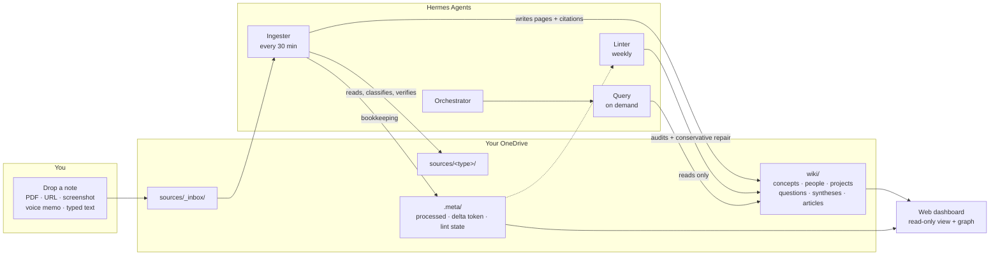

# Second Brain

**A self-hosted personal knowledge system where AI agents maintain your notes for you.**

You drop files into a folder. Agents read them, extract the meaning, write structured wiki
pages with citations, link them into a graph, and serve the whole thing as a searchable
web dashboard. Your vault stays a plain folder of Markdown in your own OneDrive — no
lock-in, no proprietary database, no vendor holding your notes hostage.



---

## Why this exists

Note-taking apps store what you wrote. They don't *think* about it. This system does the
thinking part:

- **Ingestion is automatic.** A file lands in `sources/_inbox/` and within half an hour it
  has been classified, summarised, cross-referenced, and cited.
- **Every claim is traceable.** Wiki pages carry a `sources:` array in their frontmatter.
  A page with no citation is a lint error. You can always walk a sentence back to the file
  it came from.
- **Your writing is never mangled.** The agents are bound by ten discipline rules. Code is
  reproduced character-for-character in its original language. Your phrasing survives.
  Screenshots are never dropped. Nothing is deleted — superseded pages are marked stale.
- **It audits itself.** A linter runs weekly, finds orphaned pages, broken links, schema
  violations and missing citations, fixes the unambiguous ones, and files the rest as
  questions for you.
- **It's just Markdown.** Open the vault in Obsidian, grep it, back it up with rsync, or
  read it with `cat`. The agents are a layer on top, not a cage around your data.

---

## Architecture at a glance

| Component | What it is | Where it runs |
|---|---|---|
| **Vault** | A folder of Markdown in OneDrive, opened in Obsidian | Your OneDrive |
| **`mcp-onedrive`** | TypeScript MCP server exposing 8 vault tools over stdio | Your machine |
| **4 Hermes skills** | Orchestrator, query, ingester, linter — the agent behaviour | `~/.hermes/skills/` |
| **Web dashboard** | Static site built from the vault, password-gated | Your machine / VPS |
| **Cron jobs** | Drive the ingester and linter on a schedule | Hermes cron |

The agents never touch OneDrive directly. Every read and write goes through the MCP
server, which holds a single OAuth refresh token and speaks Microsoft Graph. That gives
you one place to audit, one place to revoke.

---

## Quick start

```bash
git clone https://github.com/YOUR-USERNAME/second-brain.git && cd second-brain
cp .env.example .env && $EDITOR .env          # fill in MS_CLIENT_ID, MS_TENANT_ID, MS_REFRESH_TOKEN
./scripts/bootstrap.sh                        # checks deps, builds MCP server, installs skills, scaffolds vault
./scripts/healthcheck.sh                      # verifies token, vault layout, MCP build
```

Then start your agent and say *"what's in my inbox?"*

Full instructions — including the Azure app registration and the refresh-token capture
flow, which is the fiddliest part — are in **[docs/SETUP.md](docs/SETUP.md)**.

---

## Prerequisites

| Requirement | Why | Notes |
|---|---|---|
| **Microsoft account with OneDrive** | The vault lives there; this is the storage layer | Personal or work account both work |
| **Obsidian** (recommended) | Opens the vault natively; renders wikilinks and image embeds | Free. The vault is plain Markdown, so any editor works |
| **Node.js ≥ 18** | Runs the MCP server and the dashboard build | `node --version` |
| **Python ≥ 3.10** | Helper scripts, OCR, dashboard server | `python3 --version` |
| **Hermes Agent** | Hosts the agents, skills and cron jobs | [Install guide](https://hermes-agent.nousresearch.com/docs) |
| **An OpenAI-compatible LLM endpoint** | The agents need a model to reason with | Any provider exposing `/v1/chat/completions` |
| **Azure app registration** (free) | Grants the MCP server scoped access to *your* OneDrive | ~10 minutes, one time |

Optional: a VPS if you want the dashboard reachable when your laptop is off; a Groq API
key if you want voice-note transcription.

---

## The agents

Four skills, each with one job.

**Orchestrator** (`second-brain-hj`) — the front door. Receives every message, answers the
simple ones itself, delegates the rest. Owns the flows that don't fit a single specialist:
source re-categorisation, note splitting, recovering a vanished page.

**Query** (`second-brain-query`) — answers questions about your notes, with citations.
Read-only by design: it can write to `sources/_inbox/` (that's the capture path) and
nothing else. It searches the wiki first and only falls back to raw sources when the wiki
is thin.

**Ingester** (`second-brain-ingester`) — the workhorse. Polls `sources/_inbox/`, classifies
each file, extracts text from screenshots via OCR, fetches and summarises URLs, writes wiki
pages, updates the index, appends to the log, moves the source to its permanent bucket, and
records the whole thing in `.meta/processed.json`.

**Linter** (`second-brain-linter`) — the auditor. Weekly. Ten checks: orphan pages, broken
wikilinks, malformed frontmatter, uncited pages, stale pages, overlong pages, potential
contradictions, duplicates, under-connected pages, and dropped image embeds. Fixes only
what is unambiguous. Everything else becomes a question file in `wiki/questions/`.

Details, data flow diagrams and the ten discipline rules: **[docs/ARCHITECTURE.md](docs/ARCHITECTURE.md)**.

---

## The vault contract

The whole system is held together by one file: `CLAUDE.md` at the vault root. Every agent
reads it at the start of every session. It defines the directory layout, the frontmatter
schema, the naming conventions, and the ten rules.

The rules exist because agents will happily "improve" your writing if you let them. These
forbid it:

| # | Rule |
|---|---|
| 1 | You only ever drop files into `sources/`. You never hand-edit `wiki/` or `.meta/`. |
| 2 | Agents only write to `wiki/` and `.meta/`. They never modify source file contents. |
| 3 | Every wiki claim cites at least one source file in its frontmatter. |
| 4 | Agents never delete wiki pages — mark them `stale: true` instead. |
| 5 | Every change to `wiki/` is recorded in the append-only `wiki/log.md`. |
| 6 | No hallucinating source content. Unreadable source → stop and report. |
| 7 | `processed.json` only records fully-completed work. |
| 8 | Screenshot embeds are never dropped from the final page. |
| 9 | Code is immutable — including its language. Never reformat, never translate. |
| 10 | Preserve the writer's voice. Never delete a point. Be additive, not subtractive. |

Get the full text in [`vault-template/CLAUDE.md`](vault-template/CLAUDE.md).

---

## Repository layout

```
second-brain/
├── README.md                  ← you are here
├── LICENSE                    ← MIT
├── CONTRIBUTING.md
├── .env.example               ← every env var, documented
├── .gitignore
│
├── docs/
│   ├── SETUP.md               ← step-by-step install (start here)
│   ├── ARCHITECTURE.md        ← agents, data flow, discipline rules
│   └── CREDENTIALS.md         ← how to get each credential + security notes
│
├── mcp-onedrive/              ← TypeScript MCP server (Microsoft Graph → vault tools)
│   ├── src/
│   └── package.json
│
├── skills/                    ← the four Hermes skills
│   ├── second-brain-hj/       ← orchestrator
│   ├── second-brain-query/
│   ├── second-brain-ingester/
│   └── second-brain-linter/
│
├── vault-template/            ← empty vault scaffold + CLAUDE.md contract
│   ├── CLAUDE.md
│   ├── sources/…
│   ├── wiki/…
│   └── .meta/
│
├── webpage/                   ← optional read-only dashboard
│   ├── sync/                  ← pull vault → build static site
│   ├── server/                ← password-gated static server
│   └── ops/                   ← refresh + watchdog scripts
│
└── scripts/
    ├── bootstrap.sh           ← one-command first-run setup
    ├── healthcheck.sh         ← verify token, layout, build
    ├── get_refresh_token.py   ← device-code flow to capture MS_REFRESH_TOKEN
    └── vault_ocr.py           ← download an image from the vault and OCR it
```

---

## Web dashboard

An optional read-only window into your brain: note browser, full-text search, force-directed
knowledge graph, 3D galaxy view, and spaced-repetition review for flashcards. It syncs the
vault with ETag-delta (only changed files transfer), rebuilds a static site, and serves it
behind a password gate with rate-limited login.

```bash
cd webpage && npm install && npm run sync && npm start
```

See [webpage/README.md](webpage/README.md).

---

## Design decisions worth knowing

**Why OneDrive and not a local folder?** Because the vault has to be reachable from
wherever the agent runs — your laptop, a VPS, a cron container — and it has to survive
your laptop dying. OneDrive gives you that plus a native Obsidian client on every platform.
The MCP layer means nothing else in the system needs to know that.

**Why is the ingester's order so rigid?** Because half of its steps are hard gates against
silent data loss. The paper-trail copy is written *and byte-verified* before any wiki work
starts. Image embeds are re-checked *after* the page is written, not assumed present. The
`processed.json` record is written *last*, so a crashed run retries rather than silently
dropping a file. Each of those rules was paid for by a real bug.

**Why thirty minutes and not real-time?** Batching keeps token spend sane and lets the agent
process a backlog in one run with one model call per file instead of one per file-drop.

---

## Contributing

Bug reports, new skills, and improvements to the ingester's classification logic are all
welcome. See [CONTRIBUTING.md](CONTRIBUTING.md).

## License

MIT — see [LICENSE](LICENSE).
